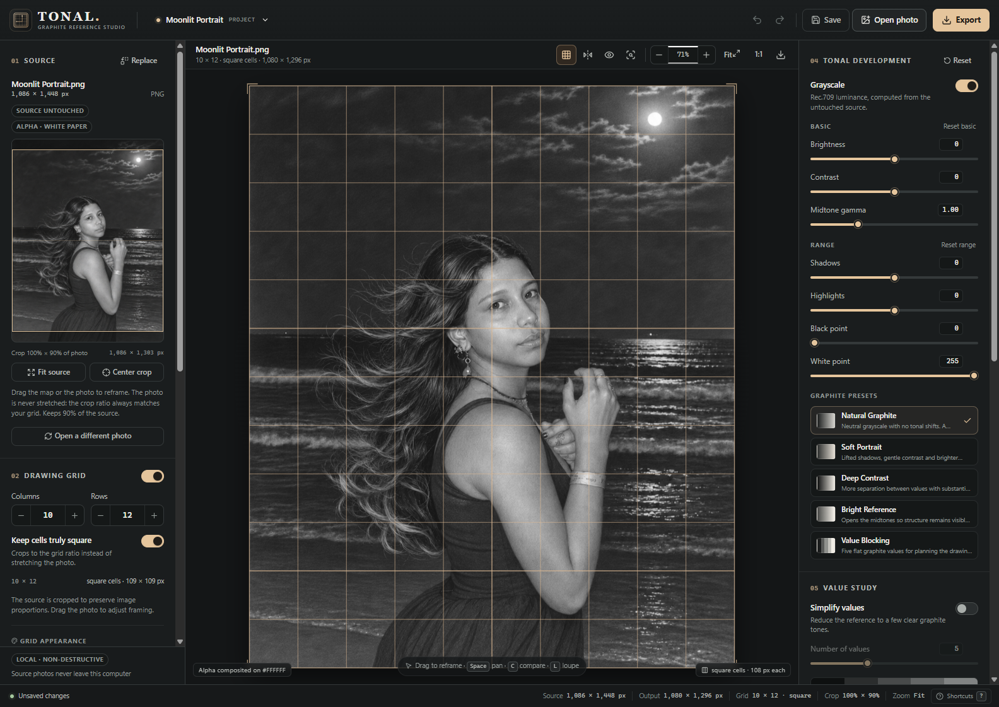
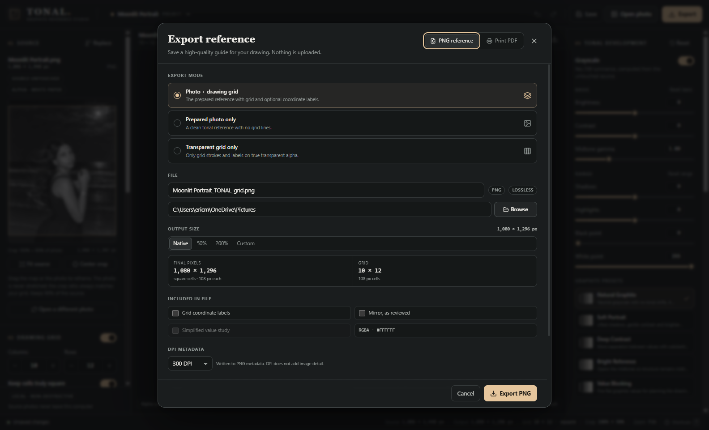
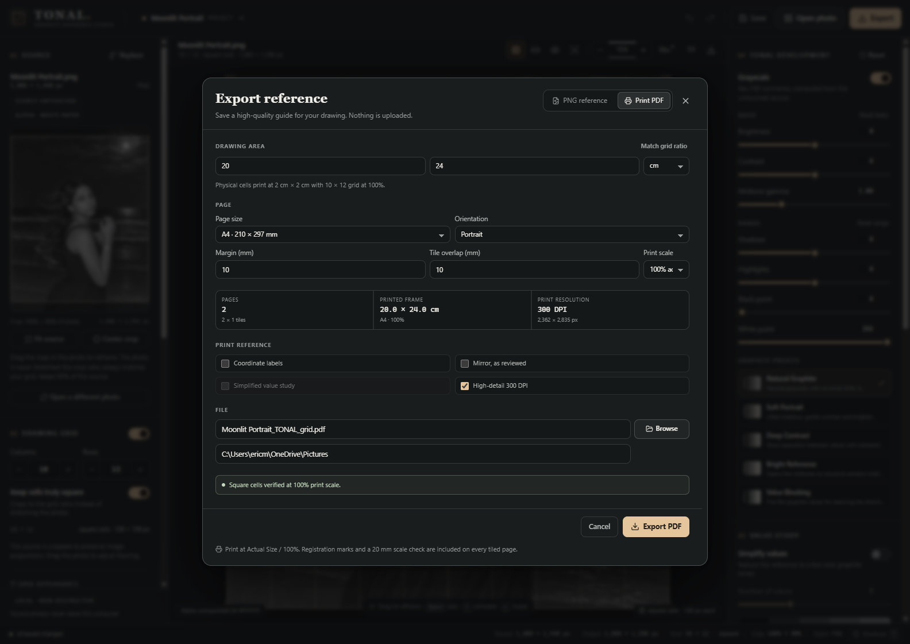

<h1 align="center">TONAL</h1>

<p align="center"><strong>GRAPHITE REFERENCE STUDIO</strong></p>

<h3 align="center"><em>Draw what you see.</em></h3>

<p align="center">
  A calm, local-first studio for turning photographs into measured graphite references.
</p>

<p align="center">
  <kbd>Windows</kbd>&nbsp;&nbsp;<kbd>macOS</kbd>&nbsp;&nbsp;<kbd>100% local</kbd>&nbsp;&nbsp;<kbd>No account</kbd>
</p>



<p align="center"><sub>Frame the reference. Set the grid. Resolve the values. Keep the photo untouched.</sub></p>

---

TONAL is for the part before the drawing starts.

Open a photograph, crop it to a grid whose cells are genuinely square, and work out the light and shadow without altering the original. When the reference feels clear, export a clean PNG or print a tiled PDF at the exact size you will draw. Every adjustment stays editable. Nothing is uploaded.

## A quieter way to prepare a drawing

| **A grid that tells the truth**                                                                                                                           | **Values before details**                                                                                                                                                  | **Paper, not pixels**                                                                                                                                           |
| :-------------------------------------------------------------------------------------------------------------------------------------------------------- | :------------------------------------------------------------------------------------------------------------------------------------------------------------------------- | :-------------------------------------------------------------------------------------------------------------------------------------------------------------- |
| Columns and rows are independent. True-square mode crops the photograph instead of stretching it, so every cell measures the same on screen and on paper. | Pull the image into graphite with black and white points, gamma, shadows, highlights and contrast. Block the scene into 3–9 values when you want to plan before rendering. | Enter the drawing area you actually use. TONAL calculates the printed cell size, warns when the proportions drift, and tiles a 100% PDF across ordinary sheets. |

## One photo. Three exports.

Every export shares the same crop and grid geometry, so the reference in front of you is the reference in the file.

| **Photo + grid**                                                               | **Photo only**                                       | **Grid only**                                                                      |
| :----------------------------------------------------------------------------- | :--------------------------------------------------- | :--------------------------------------------------------------------------------- |
| The complete drawing guide, with optional coordinate labels and a value study. | A clean grayscale or colour reference with no lines. | Just the measured grid on true transparent alpha, ready to lay over another layer. |

PNG output is rendered at full resolution by the native Rust engine, with exact output dimensions and embedded DPI metadata. No watermark and no hidden resizing.



<p align="center"><sub>Choose the mode, verify the final pixel dimensions, and export.</sub></p>

## Print it at the size you draw

Set the physical drawing area in millimetres, centimetres or inches. TONAL works out the real cell size and prepares a tiled, actual-size PDF for A4, Letter, A3 or custom paper.

Each tile carries corner registration marks, page and grid coordinates, and a 20 mm ruler check. Print at 100% and the squares on paper match the squares in the studio.



<p align="center"><sub>Actual-size printing with honest paper measurements and a built-in scale check.</sub></p>

## How it works

1. **Open a photograph.** JPG, PNG and WebP are supported. EXIF orientation is applied before the image is measured, and transparent images are composited against paper white.
2. **Set the drawing grid.** Choose columns and rows, keep cells truly square, then drag the photo or the framing map to place the crop. Mirror the reference if your drawing hand needs it.
3. **Shape the values.** Work in grayscale or colour, start from a graphite preset, or build the tonal response yourself. Use the histogram to check that detail survives in the darks and lights.
4. **Export or print.** Save a PNG reference, generate a tiled PDF, or keep the whole setup in a `.tonal` project and come back to it later.

## Made to stay out of your way

- **Undo without fear.** History, dirty-state protection and atomic project saves mean an accidental change or interrupted save cannot quietly cost you the session.
- **Find the original again.** Projects reference the photograph rather than copying it. If the file moves, TONAL can relink it while preserving the grid, crop and tonal work.
- **Look closer.** Hold **C** to compare with the original, press **L** for the loupe, and use **Space** to pan without losing your place.
- **Work at your scale.** Zoom to fit, jump to 100%, or inspect individual cells before committing to an export.
- **A real desktop app.** Native file dialogs, drag-and-drop, clipboard paste, recent projects and keyboard shortcuts, with no browser tab in the way.

## Private by design

> **Your photographs never leave this computer.**
>
> TONAL has no account, no upload, no telemetry, no cloud dependency and no watermark. The source image is read locally and is never modified. Project files store your settings, not a copy of your photo.

## Get started

### Run from source

You will need **Node.js 20+**, **npm**, and a **Rust** toolchain. On Windows, install Visual Studio Build Tools with the **Desktop development with C++** workload and a Windows 10/11 SDK. On macOS, install the Xcode command line tools.

```bash
npm install
npm run tauri:dev
```

The desktop app opens with the native imaging engine available. `npm run dev` starts only the browser UI review build; native import and export commands require the desktop app.

### Build the Windows installer

From an **x64 Native Tools Command Prompt for VS**, or after loading the Visual Studio developer environment:

```bat
npm install
npm run tauri:build -- --bundles nsis
```

The installer is written to:

```text
src-tauri/target/release/bundle/nsis/TONAL_1.0.0_x64-setup.exe
```

The unpacked executable is `src-tauri/target/release/tonal.exe`.

On the development PC used for this build, Build Tools lives under `C:\BuildTools` and its `link.exe` is shadowed by Git's unrelated `link` tool. The verified Git Bash environment is:

<details>
<summary>Exact MSVC environment used for the Windows build</summary>

```bash
export PATH="/c/BuildTools/VC/Tools/MSVC/14.44.35207/bin/Hostx64/x64:/c/Program Files (x86)/Windows Kits/10/bin/10.0.18362.0/x64:$USERPROFILE/.cargo/bin:$PATH"
export LIB="C:\BuildTools\VC\Tools\MSVC\14.44.35207\lib\x64;C:\Program Files (x86)\Windows Kits\10\Lib\10.0.18362.0\ucrt\x64;C:\Program Files (x86)\Windows Kits\10\Lib\10.0.18362.0\um\x64"
export INCLUDE="C:\BuildTools\VC\Tools\MSVC\14.44.35207\include;C:\Program Files (x86)\Windows Kits\10\Include\10.0.18362.0\ucrt;C:\Program Files (x86)\Windows Kits\10\Include\10.0.18362.0\um;C:\Program Files (x86)\Windows Kits\10\Include\10.0.18362.0\shared;C:\Program Files (x86)\Windows Kits\10\Include\10.0.18362.0\winrt"
npm run tauri:build -- --bundles nsis
```

</details>

### macOS

```bash
xcode-select --install
npm install
npm run tauri:dev
npm run tauri:build
```

macOS packaging has not been verified on the Windows machine used for this release.

## Keyboard shortcuts

| Action              | Shortcut                                |
| :------------------ | :-------------------------------------- |
| Open photo          | `Ctrl/Cmd + O`                          |
| Save / Save As      | `Ctrl/Cmd + S` / `Ctrl/Cmd + Shift + S` |
| Export reference    | `Ctrl/Cmd + E`                          |
| New project         | `Ctrl/Cmd + N`                          |
| Undo / Redo         | `Ctrl/Cmd + Z` / `Ctrl/Cmd + Shift + Z` |
| Toggle grid         | `G`                                     |
| Mirror reference    | `M`                                     |
| Hold to compare     | `C`                                     |
| Loupe               | `L`                                     |
| Fit / Actual pixels | `0` / `1`                               |
| All shortcuts       | `?`                                     |

## Under the hood

TONAL is built with **Tauri 2**, **React 19**, **strict TypeScript**, **Vite** and a **Rust** imaging core. The preview uses the same documented tone pipeline as the native renderer, and every PNG and PDF is produced locally by Rust. The PDF writer is purpose-built for actual-size tiled output rather than screen-oriented page export.

<details>
<summary>Verification notes</summary>

- Frontend: typecheck, lint and production build pass; 72 Vitest tests pass.
- Native core: 41 Rust tests pass, covering EXIF orientation, crop geometry, tonal monotonicity and TypeScript parity, alpha, labels, export dimensions, cancellation, project I/O and PDF structure.
- Windows: NSIS installer built successfully and the packaged app was launch-tested. The screenshots above were captured from the packaged Windows app and contain no watermark.
- Native Open/import was exercised while producing the screenshots. Full native export dialogs were not automated end-to-end; export and PDF behaviour is covered at the command/file level.
- Physical print calibration and macOS packaging were not verified on this Windows host.

</details>
